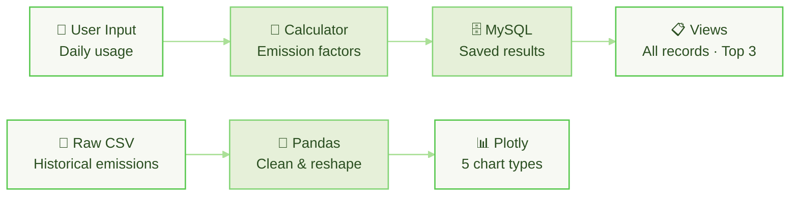

<h1 align="center">🌱 ZeroTrace</h1>
<p align="center"><b>Personal Carbon Footprint Calculator • Historical Emissions Analytics</b></p>

<p align="center">
  
  
  
  
  
  
</p>

## 📌 Executive Summary

ZeroTrace is a full-stack web app that answers two questions:

> **How much CO₂ does my daily lifestyle produce?**<br>
> **And how have emissions changed across countries and sectors over time?**

Users enter their daily electricity, fuel, travel, waste and water use. The app calculates their carbon footprint, saves it to MySQL and compares it with a global benchmark. A second part of the app shows interactive charts of historical CO₂ emissions by country and sector from **2000 to 2022**.

## 🌐 About the Project

| | |
|---|---|
| **Type** | Full-stack web application |
| **Backend** | Python, Flask, MySQL |
| **Frontend** | HTML, CSS, Jinja2 templates |
| **Data** | Historical CO₂ emissions by country and sector (2000–2022) |

## 🔄 How It Works



## 🔧 What I Did

### 1️⃣ Prepared the Historical Data
`sql_preprocessing.ipynb`

The raw dataset (`historical_emissions.csv`) had **1,176 rows**, with each year from 2000 to 2022 in its own column. Using Pandas, I:

- **Reshaped it** from wide to long format, so each row is one country, sector and year
- **Removed duplicates** and rows with zero or missing emissions
- **Exported** the clean result: **19,562 rows**, ready for charting

The data covers six sectors: Total fossil fuels and cement, Coal, Oil, Gas, Cement and Gas flaring, measured in MtCO₂e.

### 2️⃣ Designed the Database
`emissions.sql`

I created a MySQL table, `emissions`, that stores every calculation: the user's name, the emissions from electricity, transport, waste and water, the total, and a timestamp.

### 3️⃣ Built the Carbon Calculator
`db.py` · `templates/cal.html`

The form collects daily usage across four areas. Each input is multiplied by its emission factor (kg CO₂ per unit), and the results are added together:

| Category | Input | Emission Factor |
|---|---|---|
| ⚡ Electricity | kWh per day | 0.475 |
| ⛽ Fuel | Litres per day (kg for CNG) | Petrol 2.31 · Diesel 2.68 · CNG 2.74 · LPG 1.51 |
| 🚌 Public transport | km per day | 0.09 |
| ✈️ Flights | km per year, divided by 365 | Short-haul 0.25 · Long-haul 0.15 |
| 🗑️ Waste | kg per day | 0.9 |
| 💧 Water | Cubic metres per day | 0.7 |

> 💡 **Total = Electricity + Transport (fuel + bus + flights) + Waste + Water**

Every result is saved to MySQL automatically.

### 4️⃣ Built the Backend
`db.py`

A Flask app connects the pages to the database:

| Route | What It Does |
|---|---|
| `/calculator` | Shows the form, then calculates and saves the result |
| `/view_all_calculations` | Lists every saved calculation |
| `/top_3_emissions` | Shows the 3 highest totals, each marked **Above** or **Below** a global benchmark of 309.18 |
| `/graph_emissions` | Renders historical emission charts |
| `/blog` · `/about` | Information pages |

### 5️⃣ Visualized Historical Emissions
`db.py` · `templates/graph.html`

I used Plotly to build five interactive chart types from the cleaned data. All of them use a dark theme:

| Chart | Shows |
|---|---|
| 📈 Line | Emissions over time by country and sector |
| 📊 Bar | Stacked emissions by country per year |
| 🥧 Pie | Sector breakdown for the latest year |
| ⚬ Scatter | Emissions over time, by country and sector |
| 🏔️ Area | Stacked emissions by country over time |

### 6️⃣ Designed the Frontend
`templates/` · `static/`

There are seven pages built with HTML, CSS and Jinja2: Home, Calculator, Results, All Records, Top 3, Graphs, Blog and About. The home page acts as a dashboard with four buttons for the main features. The design uses a green color scheme with full-page background images and semi-transparent panels.

## 🚀 Run It

```bash
git clone https://github.com/Karthih2/ZeroTrace-Carbon-Emissions-Calculator-Mini-Project.git
cd ZeroTrace-Carbon-Emissions-Calculator-Mini-Project
pip install flask mysql-connector-python pandas plotly
```

1. Create the database and table by running `emissions.sql` in MySQL
2. Load `normalized_historical_emissions-2.csv` into a table with the same name
3. Update the database settings in `db.py`
4. Run `python db.py` and open `http://127.0.0.1:5000`

## ⚠️ Limitations

- The calculator uses fixed, general emission factors, not location-specific ones.
- Electric vehicles count as zero fuel emissions.
- There are no user accounts. All calculations are stored in one shared table.


